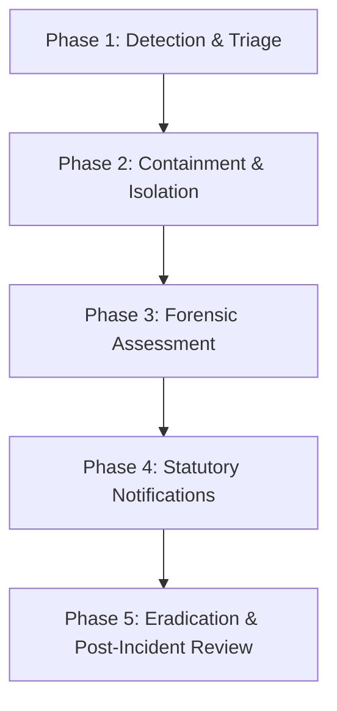

# Data Breach Response & Incident Notification Plan
**Legal Framework:** Indian Digital Personal Data Protection (DPDP) Act 2023 (Section 8(6)), DPDP Rules 2025, Information Technology Act 2000 (Section 70B), and CERT-In Directions (No. 20(3)/2022-CERT-In).

---

## 1. Overview & Objective
This incident response plan establishes immediate operational and legal protocols in the event of any actual, suspected, or threatened personal data breach, security compromise, or unauthorized exfiltration affecting **[NAME / VIKASH PORTFOLIO]**.

---

## 2. Statutory Deadlines & Reporting Obligations

| Authority / Party | Statutory Mandate | Reporting Window | Contact / Portal |
|---|---|---|---|
| **CERT-In (Indian Computer Emergency Response Team)** | IT Act 2000 s. 70B; CERT-In Directions 2022 | **Within 6 hours** of becoming aware of incident | `incident@cert-in.org.in` Phone: 1800-11-4949 Web: https://www.cert-in.org.in |
| **Data Protection Board of India (DPB)** | DPDP Act 2023 s. 8(6) & DPDP Rules 2025 | **Without undue delay** (as prescribed by DPDP Rules) | `[FILL THIS: DPB Portal URL / Email upon operationalization]` |
| **Affected Data Principals (Users)** | DPDP Act 2023 s. 8(6) | **Promptly & directly** via email/SMS | Individual notice to affected email addresses |

---

## 3. Incident Classification

- **P1 - Critical Breach:** Direct exposure or exfiltration of personal records (names, email addresses, phone numbers, contact messages, IP/geolocation tracking records), unauthorized database access, or compromised webhook/API secret keys.
- **P2 - High Severity:** Unauthorized access attempt without confirmed exfiltration; DDoS or defacement affecting availability without data leak.
- **P3 - Medium/Low:** Isolated probe, scan, or suspicious automated bot traffic successfully blocked by Web Application Firewall (WAF) / Rate Limiting.

---

## 4. Five-Phase Response Workflow

### Phase 1: Detection & Triage (Minutes 0 - 60)
1. Identify source of alert (server logs, Discord webhook abuse, Supabase anomaly, Web3Forms notice, user report).
2. Triage severity: Determine whether personal data or infrastructure credentials were compromised.
3. Mobilize the Incident Response Lead & Grievance Officer:
   - **Lead / Grievance Officer:** [FILL THIS: Vikash J / Grievance Officer]
   - **Emergency Contact:** [FILL THIS: vikash.jmbox@gmail.com / +91 9566341933]

### Phase 2: Immediate Containment (Hours 1 - 2)
1. **Rotate Compromised Credentials Immediately**:
   - Invalidate exposed Discord Webhook URL if leaked or flooded.
   - Rotate Supabase `service_role` and `anon` keys if exposed.
   - Rotate Web3Forms access key.
   - Revoke active administrative tokens / SSH keys.
2. **Isolate Affected Systems**:
   - Temporarily disable public form submissions or vulnerable endpoints if actively exploited.
   - Deploy rate-limiting IP blocks on CDN / reverse proxy (Cloudflare / Netlify / Vercel).
3. **Preserve Forensic Evidence**:
   - Export immutable server logs, CDN access logs, and database transaction logs for forensic audits. Do not reboot or erase machines without preserving memory/logs.

### Phase 3: Forensic Assessment (Hours 2 - 4)
1. Identify:
   - Exact nature of personal data impacted (e.g., contact submissions, consent records).
   - Estimated number of affected Data Principals.
   - Attack vector utilized (e.g., XSS, brute force, API vulnerability, credential theft).
   - Likelihood of harm to affected Data Principals.

### Phase 4: Statutory Notifications (Hours 4 - 6)

#### A. CERT-In Incident Notification (Within 6 Hours)
Send encrypted email to `incident@cert-in.org.in` using CERT-In incident reporting format:
- Time of incident detection
- Identification of impacted system / application
- Nature of incident (Unauthorized access / data breach)
- Technical details & indicators of compromise (IoCs)
- Immediate containment actions taken

#### B. Notice to Data Protection Board of India
Submit notification containing:
- Nature and extent of personal data breach
- Number of affected Data Principals
- Potential consequences and risks of identity harm
- Measures taken to contain and mitigate the breach
- Contact details of Grievance Officer for inquiries

#### C. Notice to Affected Data Principals
Send notification in simple, non-technical language (with Tamil translation where appropriate):
- Description of the incident and what data was involved
- Safety recommendations (e.g., beware of phishing emails or calls)
- Remedial actions implemented by the organization
- Direct contact details of the Grievance Redressal Officer

---

## 5. Phase 5: Post-Incident Remediation & Review (Days 1 - 7)
1. Close root-cause vulnerabilities.
2. Verify all RLS (Row-Level Security) policies and audit logging.
3. Update data retention and encryption procedures.
4. Document a formal Post-Incident Review (PIR) report and retain for minimum 3 years.

---

## 6. Incident Contact Directory

| Role | Name | Email | Phone |
|---|---|---|---|
| **Incident Commander** | [FILL THIS: Vikash J] | [FILL THIS: vikash.jmbox@gmail.com] | [FILL THIS: +91 9566341933] |
| **Grievance Redressal Officer** | [FILL THIS: Vikash J] | [FILL THIS: vikash.jmbox@gmail.com] | [FILL THIS: +91 9566341933] |
| **Legal / Compliance Counsel** | [FILL THIS: Legal Advisor Name] | [FILL THIS: legal@example.com] | [FILL THIS: Phone] |
| **CERT-In Incident Desk** | CERT-In Response Team | `incident@cert-in.org.in` | 1800-11-4949 |
